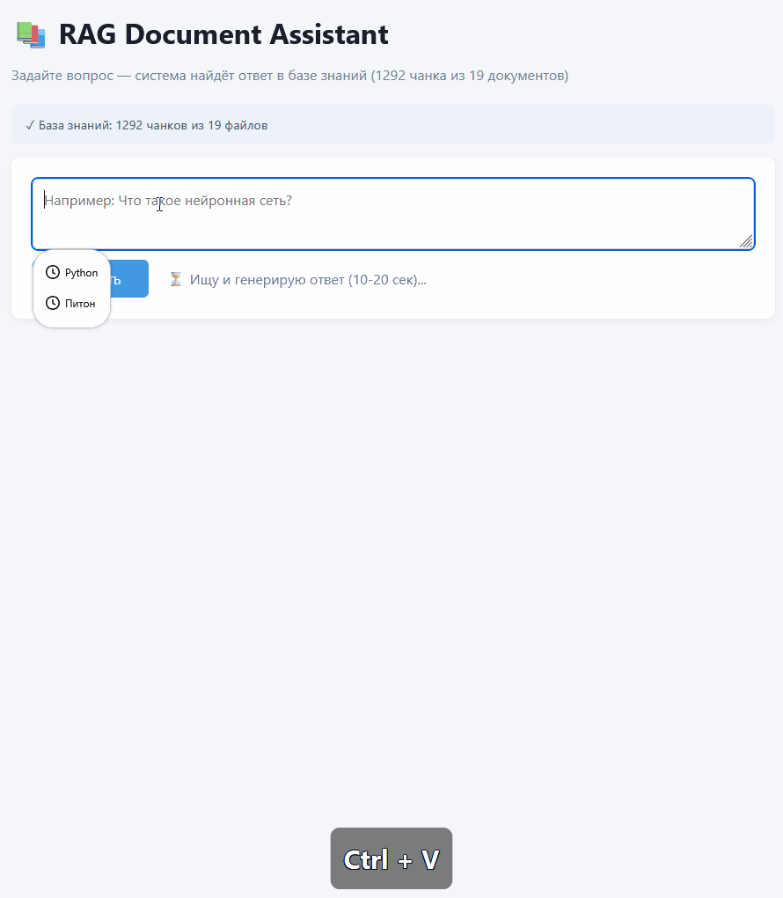

# 06 · RAG Document Assistant

Полноценная RAG-система: загрузка документов из Wikipedia, семантический поиск
по 1292 чанкам, генерация ответов через локальную LLM.



## 🎯 Что делает

Задаёшь вопрос на естественном языке → система находит релевантные фрагменты
в базе знаний → LLM формулирует ответ, опираясь **только на эти фрагменты**.

## 🏗️ Архитектура

Wikipedia API
↓ (fetch_corpus.py)
19 .txt файлов (401 KB)
↓ (indexer.py — один раз)
1292 чанка × 768-мерных вектора
↓ (сохраняется в index.pkl)
[ Поиск: cosine similarity ]
↓
Top-3 релевантных чанка
↓ (answer.py)
LLM генерирует ответ
text

## 🧠 Как работает

### 1. Эмбеддинги

Каждый чанк превращается в **вектор из 768 чисел** через модель `nomic-embed-text`.
Похожие по смыслу тексты → близкие векторы. Это позволяет искать **по смыслу,
а не по ключевым словам**.

### 2. Cosine similarity

Для запроса считается его эмбеддинг, затем — косинусное расстояние до
всех 1292 чанков. Топ-3 по score — самые релевантные.

### 3. Кэширование

Индексация корпуса — **6 минут** (1292 × вызов Ollama). Результат сохраняется
в `index.pkl`, при следующем запуске **загрузка за 0.05 секунды** (в 7000 раз быстрее).

### 4. Защита от галлюцинаций

LLM получает жёсткий промпт: «Отвечай ТОЛЬКО на основе фрагментов. Если ответа
нет — скажи "не нашёл"». На вопрос «Как приготовить борщ?» система честно
отвечает: «В этих фрагментах нет информации».

## 🛠️ Стек

- **Python 3.14** — язык
- **Ollama + nomic-embed-text** — эмбеддинги (274 МБ)
- **Ollama + qwen2.5:3b** — генерация ответов
- **FastAPI** — бэкенд
- **BeautifulSoup4** — парсинг Wikipedia
- **pickle** — кэш индекса
- **HTML/CSS/JS** — фронтенд

## 🚀 Запуск

```bash
# 1. Установи зависимости
pip install -r requirements.txt

# 2. Скачай модели Ollama
ollama pull nomic-embed-text
ollama pull qwen2.5:3b

# 3. Собери корпус (один раз)
python fetch_corpus.py

# 4. Построй индекс (один раз, ~6 минут)
python indexer.py

# 5. Запусти веб-сервер
uvicorn app.main:app --reload
```

# 6. Открой в браузере
# http://127.0.0.1:8000