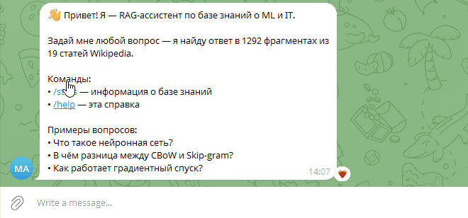

## 07 · Telegram RAG Bot

Telegram-бот с RAG-агентом. Отвечает на вопросы по базе знаний из 1292 чанков (19 статей Wikipedia), используя локальную LLM.



## 🎯 Что делает

    /start — приветствие

    /stats — информация о базе знаний

    Любой текст — вопрос к RAG-системе


Бот переиспользует RAG-ядро из проекта 06.

## 🏗️ Архитектура

Бот использует Cloudflare Worker в качестве API-прокси для Telegram. Это позволяет развернуть бота на серверах, где прямой доступ к API ограничен, или использовать Worker как serverless-балансировщик.

Пользователь в Telegram
↓
Cloudflare Worker (worker.js) — прокси для API
↓
Python-бот (aiogram) ←→ RAG-ядро (index.pkl) ←→ Ollama (qwen2.5:3b)

## 🛠️ Стек

    aiogram 3.x — фреймворк для Telegram

    Cloudflare Workers — API-прокси

    python-dotenv — загрузка токена

    RAG-ядро — из проекта 06

## 🚀 Запуск

1. Получи токен бота

У @BotFather (https://t.me/BotFather): отправь /newbot, придумай имя и username. Скопируй полученный токен.
2. Настрой .env

Скопируй файл-шаблон и заполни его своими данными:

```bash
cp .env.example .env
```

Открой файл .env и вставь свои значения:

```bash
TELEGRAM_BOT_TOKEN=твой_токен_от_BotFather
WORKER_URL=https://telegram-api-proxy.<твой-ник>.workers.dev
```

(URL Cloudflare Worker'а нужно получить отдельно при его создании, он используется как прокси для Telegram API).

## 3. Установи зависимости и запусти

pip install -r requirements.txt
python bot.py