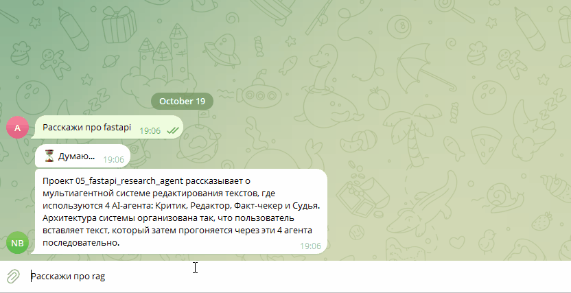

# 08 · n8n AI Portfolio Assistant

Интеграция Telegram-бота, Python-микросервиса и low-code платформы n8n (в Docker) для создания AI-ассистента по моему портфолио.



## 🎯 Что делает

Пользователь задает вопрос в Telegram-боте (например, «Какие проекты с RAG ты делал?»). Бот передает вопрос в n8n, который собирает контекст с GitHub через Python-сервис и генерирует ответ с помощью локальной LLM.

## 🏗️ Архитектура

Пользователь (Telegram)
↓
Python-бот (aiogram)
↓ (HTTP POST)
n8n Webhook (Docker)
↓
n8n HTTP Request → Python FastAPI (сбор контекста с GitHub API)
↓
n8n Basic LLM Chain → Ollama (qwen2.5:3b)
↓
n8n Respond to Webhook
↓ (HTTP Response)
Python-бот (aiogram) → Пользователь


## 🛠️ Стек

- **n8n** — low-code оркестрация (Webhook, HTTP Request, LLM Chain)
- **Docker & docker-compose** — контейнеризация n8n и Python-сервиса
- **Python (FastAPI)** — микросервис для сбора данных с GitHub API
- **Python (aiogram)** — Telegram-бот
- **Ollama** — локальная LLM для генерации ответов

## 🚀 Запуск

1. Убедись, что Ollama запущена (модель `qwen2.5:3b`).
2. Запусти инфраструктуру:
   ```bash
   docker-compose up -d
   ```
3. В n8n (http://localhost:5678) собери Workflow: Webhook → HTTP Request → Basic LLM Chain → Respond to Webhook. Опубликуй его (Publish).

4. Настрой токен бота в .env.

Запусти бота:
   ```bash
python bot.py
   ```