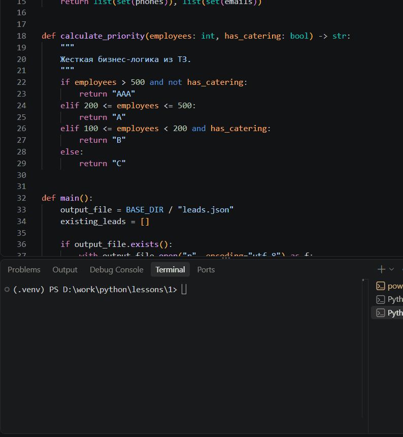

# B2B Lead Generator

Проект по автоматизации сбора, ранжирования и выгрузки B2B-лидов. Архитектура закрывает требования реальных коммерческих задач по сбору данных для холодных продаж.

## Возможности
1. **Сбор данных:** Модуль парсинга (Playwright) собирает данные о компаниях (в текущей версии используются тестовые данные для демонстрации пайплайна).
2. **Извлечение контактов:** Регулярные выражения вытаскивают телефоны и email из текста.
3. **Бизнес-логика:** Детерминированный алгоритм на Python рассчитывает приоритет лида (AAA, A, B, C) на основе численности сотрудников и наличия питания. 
4. **Дедупликация:** Отсев дубликатов происходит по ИНН компании до сохранения в базу.
5. **Интеграция:** Скрипт отправляет массив новых лидов и статистику в n8n через Webhook.
6. **Оркестрация (n8n):** 
   - Разделяет данные на отчет для Telegram и строки для Google Sheets.
   - Записывает новые лиды в Google Sheets.
   - Отправляет красивый отчет в Telegram (через Cloudflare Worker для обхода блокировок).

## Запуск
1. Запустить n8n (конфигурация в папке `infra`).
2. Активировать воркфлоу в n8n (Webhook -> Code -> Split Out -> Google Sheets / HTTP Request).
3. Установить зависимости `pip install -r requirements.txt`.
4. Запустить `python parser.py`.