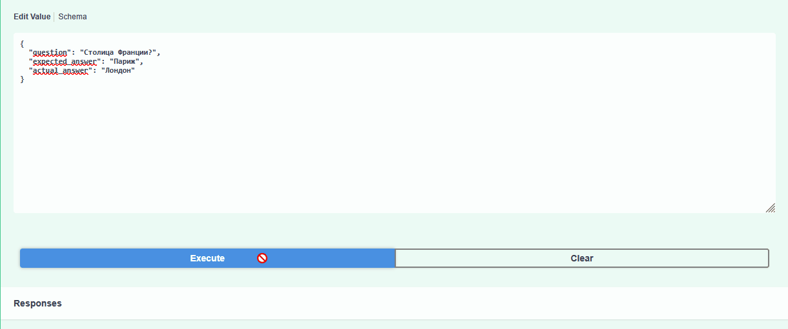

# LLM Evaluator Service

Микросервис для оценки качества ответов LLM (LLM-as-a-Judge). 
Проект закрывает требования к Middle/Senior AI Engineer: работа с Docker, PostgreSQL, FastAPI, тестирование и локальные LLM.



## Архитектура
- **FastAPI**: REST API для приема вопросов и ответов на оценку.
- **PostgreSQL**: хранение истории оценок и аргументации судьи (SQLAlchemy).
- **Ollama (qwen3.5:2b)**: локальная модель, которая выступает в роли "Судьи" (LLM-as-a-Judge).
- **Docker Compose**: поднимает API и базу данных одной командой.
- **Pytest**: автотесты с моками (mocking) для проверки эндпоинтов без реальных вызовов LLM.

## Запуск
1. Убедитесь, что Ollama запущена на хосте и скачана модель: `ollama pull qwen3.5:2b`.
2. Запустите сервисы:
   ```bash
   docker compose up -d --build

3. Документация API (Swagger) доступна по адресу: http://localhost:8000/docs.