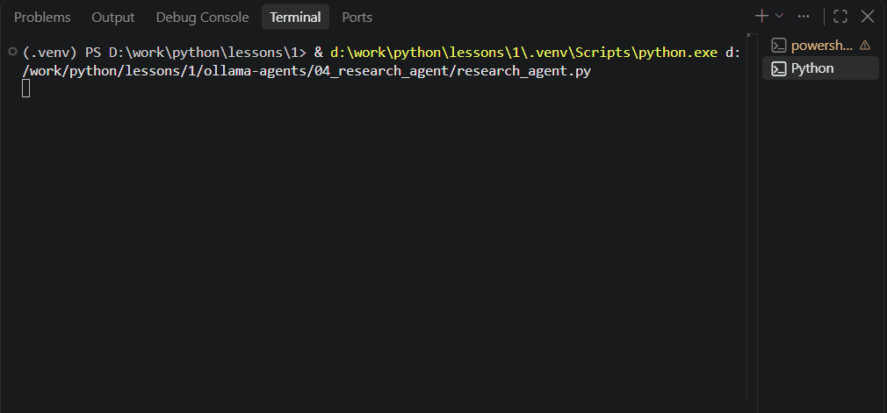

# Ollama Agents — коллекция локальных ИИ-агентов

Учебный проект: **4 агента на локальной LLM** (Qwen2.5:3B через Ollama). 
Демонстрирует прогресс от простого tool calling до агента с верификацией фактов.

## 🎯 Цель проекта

Изучить архитектуру ИИ-агентов на практике: от простого вызова одной функции 
до многошагового цикла с памятью, контекстом и проверкой фактов.

## 🧰 Стек технологий

- **Python 3.14**
- **Ollama** — локальный рантайм для LLM
- **Qwen2.5:3B** — модель на 3B параметров, работает на GPU 4 ГБ
- **ddgs** — поиск в интернете без API-ключей
- **BeautifulSoup4** — парсинг HTML
- **requests** — HTTP-запросы

## 📦 Проекты

| # | Проект | Что демонстрирует |
|---|---|---|
| 01 | [Weather Agent](./01_weather_agent/) | Базовый tool calling: погода, время, калькулятор |
| 02 | [Notes Agent](./02_notes_agent/) | Работа с файлами, санитайзеры, защита от галлюцинаций |
| 03 | [Calculator Agent](./03_calculator_agent/) | **Agentic loop**: многошаговые задачи, память переменных |
| 04 | [Research Agent](./04_research_agent/) | **Внешние API**, работа с ошибками, **верификация фактов** |
| 05 | [Multi-Agent Editor](./05_fastapi_research_agent/) | **Sub-agents**, diff-подход, FastAPI + Frontend |
| 06 | [RAG Document Assistant](./06_rag_assistant/) | **RAG**, эмбеддинги, семантический поиск, FastAPI |
| 07 | [Telegram RAG Bot](./07_telegram_rag_bot/) | Интеграция с Telegram, Cloudflare Worker, aiogram |
| 08 | [n8n Portfolio Assistant](./08_n8n_portfolio_assistant/) | **n8n, Docker**, FastAPI, Telegram, AI-оркестрация |
| 09 | [B2B Lead Generator](./09_b2b_lead_generator/) | **n8n, Telegram**, AI-ранжирование, Google Sheets |
| 10 | [LLM Evaluator](./10_llm_evaluator/) | **FastAPI, PostgreSQL, Docker**, LLM-as-a-Judge, Pytest |

**Research Agent в действии** — поиск в интернете и проверка фактов:



## 🚀 Как запустить

### 1. Установи Ollama
Скачай с [ollama.com](https://ollama.com/) и запусти.

### 2. Скачай модель
```bash
ollama pull qwen2.5:3b
```

## 📄 Лицензия

MIT — используй как хочешь.
